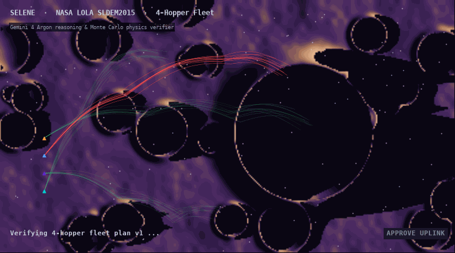

<div align="center">

# Selene

### A hopper drone that learns to survive the lunar far side at night

**Selene trains a hopper drone to work alone on the far side of the Moon, where Earth is never in view. It travels crater to crater through lunar night, learning a world model of the terrain as it goes. Gemini 4 Argon writes the safety rules and the reward, plans the route, and reads where the world model is wrong. Every route is verified before it flies.**

[](https://github.com/Nabzx/selene/actions/workflows/ci.yml)
[](LICENSE)
[](https://aistudio.google.com/learn/gemini-4-argon-developer-guide)



<sub>Concept render, not live output. Replaced by a capture of the running app once it exists.</sub>

</div>

---

## About

The far side of the Moon is not dark all the time, but it is cut off: Earth is never above the horizon, so nothing there can be flown by hand. During the two-week lunar night it drops below -170 °C and solar power is gone. A drone working there has to plan, act and recover on its own, with only occasional contact through a relay orbiter.

Selene trains one.

1. **A simulated far side.** A hand-built simulator on real LOLA terrain is the ground truth: craters, slopes, night temperatures, battery drain, relay windows.
2. **A learned world model.** The hopper learns a small model that predicts what each hop will do, and plans inside it, the way an autonomous machine on Earth would learn a mine it has never seen.
3. **Argon designs the job.** Gemini 4 Argon reads mission documents and writes a machine-checkable safety spec, writes the reward, and rewrites it from the training curves.
4. **Argon plans the route.** It picks which craters to visit and in what order.
5. **The verifier tries to break it.** The simulator replays the route about a thousand times with noise. Each run is checked against the spec. Green passes, red fails. Argon revises until it passes.
6. **Argon reads the world model's mistakes.** Where predictions and reality disagree, Argon explains why and proposes a fix.
7. **A person approves the uplink**, during the next relay window.

The 3D view plays logged training episodes from a shared JSON file. Training is real, the 3D playback is a replay of it.

Full summary: [`docs/OVERVIEW.md`](docs/OVERVIEW.md).

## Track

Gemini 4 Argon one-day hackathon, **autonomous systems that reason and verify**.

## Models

| Job | Model |
|---|---|
| Safety spec, reward design, route planning, world-model error analysis | `gemini-4-argon` |
| Mission log narration, parallel scenario summaries | `gemini-3.8-flash` |
| Action guardrail on every proposed hop | `gemini-3.5-flash-lite` |

All model calls use the Interactions API through `google-genai`.

## Run it locally

Needs [uv](https://docs.astral.sh/uv/), Python 3.12+ and a Gemini API key.

```
git clone https://github.com/Nabzx/selene.git
cd selene
cp .env.example .env        # add GEMINI_API_KEY

# simulator, training, verifier and Argon backend
cd apps/sim
uv run uvicorn selene_sim.api:app --reload

# 3D view, in a second terminal, from the repo root
python3 -m http.server 5173 --directory apps/web
```

Open [http://localhost:5173](http://localhost:5173).

Status: scaffold. See [`ROADMAP.md`](ROADMAP.md).

## Structure

```
apps/sim     simulator, world model, RL training, verifier, Argon calls
apps/web     no-build Three.js view, plays data/episodes.json
data/        terrain crop and logged episodes (raw downloads are gitignored)
docs/        overview, ADRs, datasets, episode schema, demo script
scripts/     one-off tools, including the concept GIF renderer
```

This repository follows a phase-and-wayfinder structure. See [`AGENTS.md`](AGENTS.md) and [`ROADMAP.md`](ROADMAP.md).

## Licence

[MIT](LICENSE).
