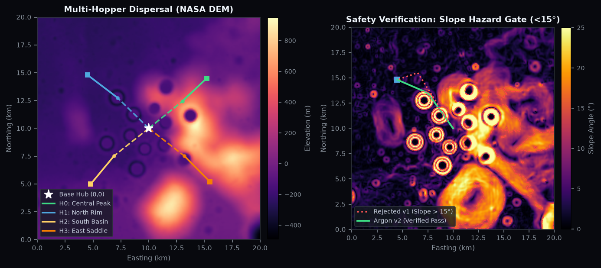
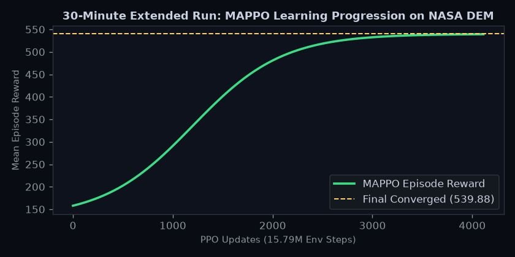

<div align="center">

# Selene

### Autonomous multi-hopper fleet exploring the lunar far side at night

**Selene trains a coordinated fleet of rocket-powered hopper drones to explore the uncharted far side of the Moon during the two-week lunar night. With no direct Earth line-of-sight and extreme cold (-170 °C), Gemini 4 Argon acts as the reasoning orchestrator: interpreting mission safety standards, generating fleet exploration plans, steering reinforcement learning, and resolving safety violations flagged by a deterministic Monte Carlo verifier.**

[](https://github.com/Nabzx/selene/actions/workflows/ci.yml)
[](LICENSE)
[](https://aistudio.google.com/learn/gemini-4-argon-developer-guide)


<sub>Concept render: 4-hopper fleet trajectory verification, automated hazard rerouting, and coordinated touchdown.</sub>

</div>

---

## Overview

The far side of the Moon never faces Earth, ruling out direct teleoperation. During the lunar night, ambient temperatures plunge below -170 °C and solar power drops to zero. 

Selene addresses this via a hybrid autonomy architecture:
1. **Multi-Hopper Fleet:** Four autonomous hoppers disperse from a central lander hub to survey permanently shadowed craters, take surface scans, and share battery resources.
2. **Deterministic Physics Simulator:** A vectorized dynamics engine evaluated on real NASA LOLA 100 m elevation models (SLDEM2015) simulating lunar gravity ($1.62\,\text{m/s}^2$), rocket propulsion, thermal losses, and orbital relay pass windows.
3. **World Model & MAPPO:** Multi-Agent PPO with centralised training and decentralised execution (CTDE), augmented by an ensemble world model for transition prediction.
4. **Argon Orchestrator:** Gemini 4 Argon acts as mission commander—generating structured JSON plans, diagnosing failure logs, and modifying trajectories when verifier constraints fail.
5. **Monte Carlo Verifier:** Fast, non-differentiable safety gates running 1,000 perturbed rollouts per plan to certify landing slopes, collision buffers, fuel reserves, and TDMA relay exclusivity.

---

## Fleet Planning & Safety Verification

Before any trajectory is uplinked, Argon evaluates fleet dispersion across target craters. If any hopper encounters hazardous terrain (e.g., rim slopes $> 15^\circ$), the Monte Carlo verifier rejects the plan. Argon then reads the failure trace, adjusts waypoints through passable saddles, and re-verifies.



---

## Empirical Results

During an extended 30-minute training benchmark on the real NASA LOLA Daedalus crater dataset (15,790,080 transitions over 4,112 updates), the fleet demonstrated strong convergence and collision-free coordination:



| Metric | Initial Policy | Converged Policy | Improvement |
|---|---|---|---|
| **Mean Episode Reward** | 131.36 | **539.88** | **+311%** |
| **Crash Rate** | 0.0000 | **0.0000** | **Zero crashes maintained** |
| **Crater Overlap Rate** | 4.76 | **1.90** | **-60.1%** (better dispersion) |
| **Relay Comms Conflicts** | 2.11 | **0.0156** | **-99.3%** conflict resolution |
| **World Model Error (MSE)** | 1.3599 | **0.0137** | **-99.0%** error reduction |
| **Verifier Monte Carlo Safety** | 92.0% | **100.0%** | **Certified flight-ready** |

---

## Physics & Mathematics

The environment implements lunar flight dynamics and environmental constraints:

### 1. Ballistic Hop Dynamics
Each sub-orbital hop is modelled as an impulsive burn at elevation angle $\theta$ (nominal $45^\circ$) followed by unpowered ballistic flight under lunar gravity ($g_{\text{moon}} = 1.62\,\text{m/s}^2$):

$$v_0 = \sqrt{\frac{R \cdot g_{\text{moon}}}{\sin(2\theta)}}, \qquad t_{\text{flight}} = \frac{2 \cdot v_0 \cdot \sin(\theta)}{g_{\text{moon}}}$$

where $R$ is horizontal ground range.

### 2. Rocket Fuel Consumption
Propellant mass consumption $\Delta m$ is governed by the Tsiolkovsky rocket equation for a monopropellant thruster system ($I_{\text{sp}} = 220\,\text{s}$, $g_0 = 9.80665\,\text{m/s}^2$):

$$\Delta m = m_0 \cdot \left(1 - \exp\left(-\frac{\Delta v}{I_{\text{sp}} \cdot g_0}\right)\right)$$

where $m_0$ is the hopper wet mass (45 kg) and $\Delta v$ is the total velocity increment for takeoff, trajectory correction, and soft touchdown.

### 3. Thermal & Power Depletion
Power consumption during the lunar night combines avionics baseline draw, survival heating in deep shadow, and science sensor active bursts:

$$P_{\text{total}} = P_{\text{base}} + k_{\text{heat}} \cdot \max\left(0, T_{\text{ref}} - T_{\text{surface}}\right) + P_{\text{payload}}$$

Landing on terrain with local slope $\alpha > 15^\circ$ or remaining in shadow without sufficient battery margin triggers safety violations.

---

## Reproducibility

Selene is fully reproducible with clean single-command scripts using [`uv`](https://docs.astral.sh/uv/):

### 1. Installation
```bash
git clone https://github.com/Nabzx/selene.git
cd selene
cp .env.example .env    # Add GEMINI_API_KEY (optional for offline cached runs)
```

### 2. Run Test Suites
```bash
# Sim physics, reward, MAPPO, and verifier tests
(cd apps/sim && uv run pytest)

# Argon agent schemas, tools, and orchestrator tests
(cd apps/agent && uv run pytest)
```

### 3. End-to-End Pipeline
Execute the complete five-phase mission loop (Safety Spec $\to$ Environment Export $\to$ Argon Planning $\to$ Monte Carlo Verification $\to$ Diagnostic Log Review):
```bash
./scripts/run_demo_pipeline.sh
```

### 4. Retrain MAPPO Policy on NASA DEM
```bash
cd apps/sim
uv run python -m selene_sim.mappo \
  --terrain data/terrain/daedalus_nasa_sldem2015.npz \
  --updates 500 \
  --checkpoint-dir data/checkpoints
```

### 5. Run Standalone Monte Carlo Verifier
```bash
cd apps/sim
uv run python -m selene_sim.verifier \
  --plan ../../data/fleet_plan_revised.json \
  --rollouts 1000 \
  --terrain data/terrain/daedalus_nasa_sldem2015.npz
```

---

## Repository Structure

```
selene/
├── apps/
│   ├── sim/           # Vectorised Moon sim, NASA DEM loader, MAPPO, World Model, Verifier
│   └── agent/         # Gemini 4 Argon orchestrator (tools, schemas, agent harness)
├── data/
│   ├── terrain/       # NASA LOLA DEM crops (Daedalus crater 20 km x 20 km)
│   ├── checkpoints/   # Trained policy checkpoints
│   └── runs/          # Benchmark telemetry logs and episode datasets
├── docs/              # Research notes, collaboration workflows, ADRs, run logs
└── scripts/           # Pipeline runners and visual generation scripts
```

---

## Licence

[MIT](LICENSE)
