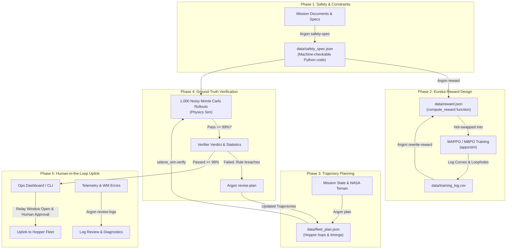

# Unified Workflow & Collaboration Guide: RL/Sim & Argon Orchestrator

This document outlines the unified architecture, data contracts, and division of responsibilities between **RL / Physics Simulation** (`apps/sim`) and the **Argon Orchestrator** (`apps/agent`) to deliver the vision described in [`README.md`](../README.md) and [`docs/SUMMARY.md`](SUMMARY.md).

---

## 1. Core Philosophy & Division of Responsibilities

```
"A model proposes, code checks, a person decides."
```

| Domain | Owner | Directory | Core Mission |
|---|---|---|---|
| **RL / World Models / Physics Sim** | **You** | `apps/sim` | **Ground truth & policy learning.** Ingests real NASA LOLA DEMs, calculates ballistic hop physics, trains the hopper fleet using MAPPO & MBPO, executes ~1,000 Monte Carlo verifier rollouts, and logs telemetry. |
| **Argon Orchestrator** | **Your Peer** | `apps/agent` | **Reasoning & verification.** Gemini 4 Argon managed agent that parses unstructured mission constraints into executable safety rules, authors & rewrites reward functions, generates fleet plans, reads verifier failure statistics to revise plans, and explains world model errors. |

---

## 2. System Architecture & The 5-Phase Mission Loop

The system operates in a single closed-loop workflow across five distinct phases:



---

## 3. How the Codes Connect (Shared Contracts & Interfaces)

The bridge between `apps/sim` and `apps/agent` is established through Python packages, data schemas, and the CLI:

### 3.1. Dependency & Module Linkage
`apps/agent/pyproject.toml` links `apps/sim` as an editable workspace dependency:
```toml
[project]
dependencies = [
    "selene-sim",
    "numpy>=2.5.4",
    "pydantic>=2.11.0",
    "google-genai>=2.30.1",
]
[tool.uv.sources]
selene-sim = { path = "../sim", editable = true }
```

### 3.2. Concrete Interface Points

1. **Safety Spec Execution (`apps/sim/selene_sim/verify.py` & `apps/agent/selene_agent/tools.py`)**:
   - Argon writes Python functions: `def check(trace: dict) -> tuple[bool, str, dict]: ...`.
   - `trace` delivers numpy arrays: `fuel (R, H, S+1)`, `landing_slope_deg (R, H, S)`, `min_separation_m (R, S)`, `relay_conflict (R, S)`.
   - Simulator runs this against 1,000 rollouts without calling any LLM.

2. **Eureka Reward Hot-Swapping (`apps/sim/selene_sim/reward.py`)**:
   - Argon generates: `def compute_reward(state, actions=None, next_state=None) -> tuple[np.ndarray, dict]: ...`.
   - Sim calls `register_reward_function(fn)` live inside `VectorLunarEnv` without restarting training.

3. **Fleet Plan & Trajectory Cloud (`apps/sim/selene_sim/verify.py` & `apps/agent/selene_agent/schemas.py`)**:
   - Argon plans hoppers, crater sequences, and hop times conforming to `FleetPlan`.
   - `verify.py` runs `simulate_plan()` and returns:
     - `pass_rate: float`
     - `failures_by_rule: dict[str, int]`
     - `worst_failure: dict`
     - `trajectory_cloud: list[dict]` (for 3D visual rendering)

4. **World Model Error Hotspots (`apps/sim/selene_sim/world_model.py`)**:
   - Sim computes epistemic uncertainty: $\sigma^2(x, a) = \frac{1}{M}\sum (f_i(x, a) - \bar{f}(x, a))^2$.
   - Argon reads `get_world_model_error_map` to alert operators where terrain prediction error is high.

---

## 4. Work Checklist for You & Argon Orchestrator Guy

### For You (RL, World Models & Sim)
- [x] Ingest real NASA LOLA 100m SLDEM2015 topography (`apps/sim/scripts/fetch_nasa_dem.py`).
- [x] Run long-duration background MAPPO training with curriculum & TDMA coordination.
- [x] Vectorised 1,000-rollout Monte Carlo verifier executing under 10 seconds.
- [ ] **Deliverable 1:** Export benchmark checkpoint and comprehensive telemetry report (`run-08-mappo-nasa-extended-30min.md`).
- [ ] **Deliverable 2:** Ensure `apps/sim/selene_sim/api.py` exposes `/verify`, `/reward/hot-swap`, and `/world-model/errors` so Argon can invoke them either via Python import or HTTP.

### For Argon Orchestrator Guy (`apps/agent`)
- [x] Set up Google managed agent `selene-orchestrator` with `gemini-4-argon`.
- [x] Implement the 5 core CLI commands: `safety-spec`, `reward`, `plan`, `revise`, `review-logs`.
- [x] Sandbox Python check & reward compilation with restricted builtins.
- [x] **Deliverable 1:** Ensure multi-turn revision loop passes verifier failures back to Argon until `pass_rate >= 0.99`.
- [x] **Deliverable 2:** Add human-in-the-loop signoff CLI prompt before outputting the final approved uplink package.

### Joint Deliverables (You + Argon Guy)
- [ ] **Single End-to-End Demo Script (`scripts/run_demo_pipeline.sh`)**:
  A single script executing the complete pipeline without manual intervention:
  1. Parse `docs/SUMMARY.md` into `data/safety_spec.json`.
  2. Plan trajectories for 4 hoppers across Daedalus crater into `data/fleet_plan.json`.
  3. Verify against 1,000 noisy rollouts in NASA DEM physics sim.
  4. If verification fails, Argon automatically revises until pass rate $\ge 99\%$.
  5. Prompt operator for human signoff, then export the verified uplink JSON.
